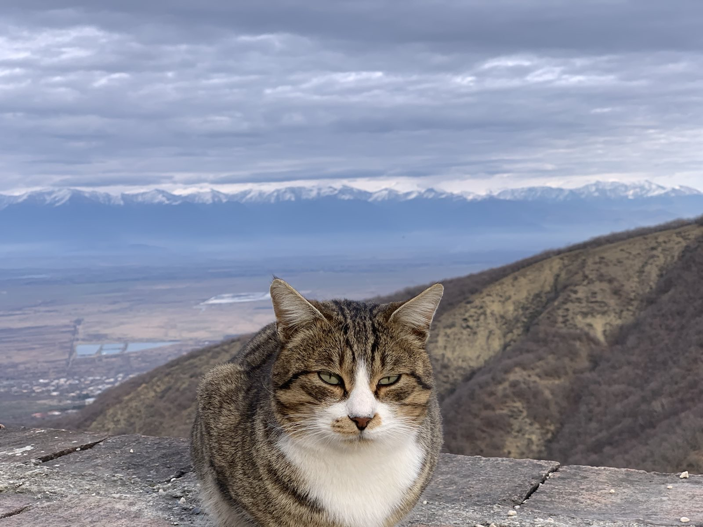

I am a social researcher. I use large longitudinal survey data to study how social conditions affect health and wellbeing during the life course. I also develop a tool for transparent evidence review.

I am completing a [PhD in Social Sciences at Universidad Carlos III de Madrid](https://www.uc3m.es/phdprogram/social-sciences#home){:target="_blank"}.

My main research area is **neurocognitive ageing**. This field studies how memory, learning and processing speed change with age, and why these changes differ between individuals. I use long-term surveys from Europe and the United States to study how social and family conditions in childhood affect memory in later life.

I also study social status and health: how social origin affects the pace of biological ageing, how people's perception of their own social status affects their health, and how wellbeing and self-rated health change over time in different countries.

## CatEye

I am developing [CatEye](https://cat-eye.streamlit.app/){:target="_blank"}, an open-access tool that extracts evidence from documents. The user supplies a library of PDF documents and a set of concepts. CatEye finds the passages that match each concept and returns the exact text with its source. It does not generate new text. The current version is an early proof of concept.

---

🐾 I love cats. This cat lives in the gardens of the Monastery of St. Nino at Bodbe, Georgia. The Caucasus mountains are behind her.
{: .cat-caption}
